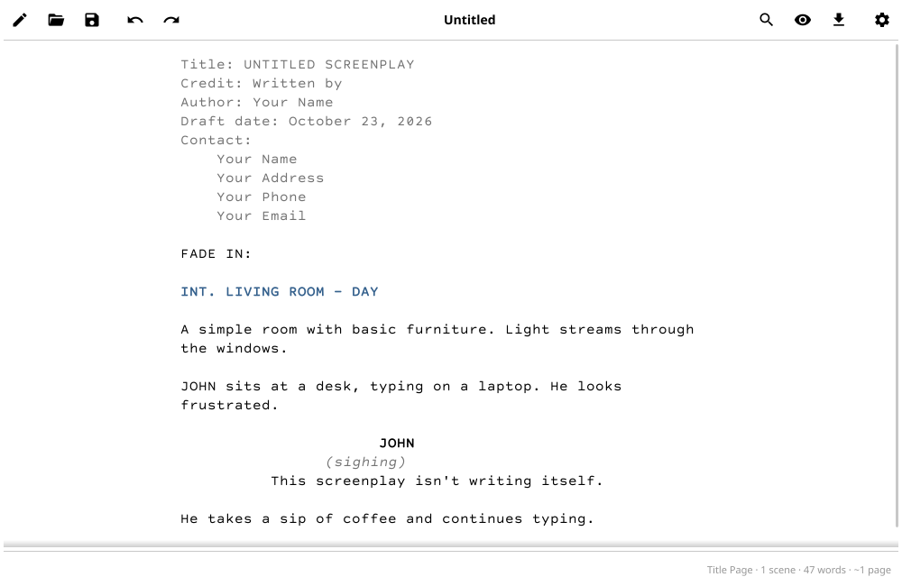

# Accolade



## About

Accolade is a distraction-free Fountain editor for screenwriters, built with [Fyne](https://fyne.io) in Go. Originally forked from a GTK-based application, Accolade has been completely rewritten to provide faster compilation, better cross-platform support, and easier deployment. It uses lexington as back-end for parsing Fountain and offers a clean, modern user interface optimized for distraction-free writing.

Accolade was migrated from GTK4 to Fyne; see
[FYNE_TRANSITION.md](FYNE_TRANSITION.md) for the background and
[BUILD_STATUS.md](BUILD_STATUS.md) for what works today, how to test it,
and what is still missing.

## Building

### Prerequisites

- Go 1.21 or later
- GCC compiler
- X11 development libraries (Linux only)

On Ubuntu/Debian:
```bash
sudo apt-get install libx11-dev libxrandr-dev libxcursor-dev \
                     libxinerama-dev libxi-dev libgl1-mesa-dev \
                     build-essential pkg-config
```

### Quick Start

The easiest way to build Accolade:

```bash
./build-fyne.sh
```

### Manual Build

```bash
export CGO_ENABLED=1
go mod tidy
go build -v -o accolade .
```

### Using Nix

For development with the included Nix flake:

```bash
nix develop
go build -v -o accolade .
```
